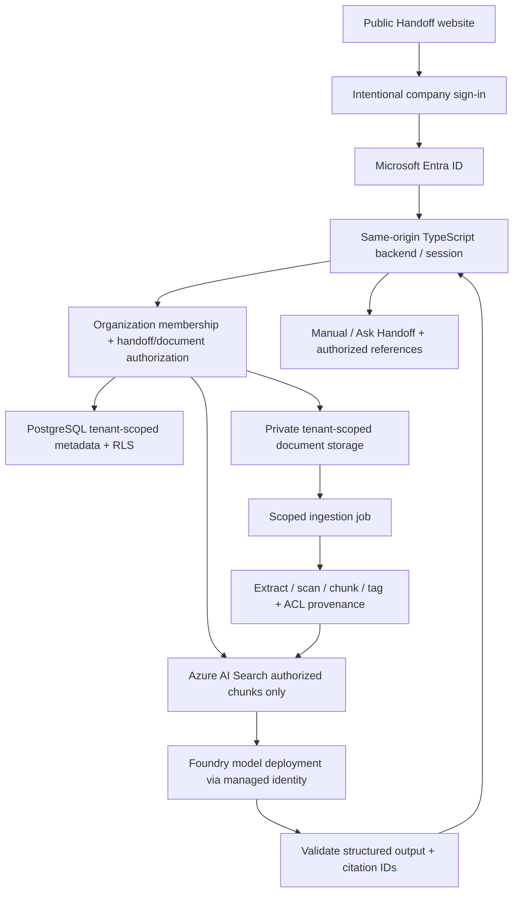

# Microsoft AI integration proposal — for review before implementation

## Decision and current status

Recommend **Microsoft Foundry-hosted models (including Azure OpenAI deployments) behind Handoff's own TypeScript backend**, with Microsoft Entra ID and authorization-aware retrieval. Keep Handoff a standalone SaaS with a public landing page; corporate sign-in is an intentional action. Keep the existing fictional demo as a clearly separate mode.

This document is an implementation proposal, not a working integration. No Microsoft account, model deployment, endpoint, or app registration has been configured or tested. No production documents have been uploaded. No frontend keys or backend credentials were added. Existing AI remains explicitly simulated until the real service passes acceptance tests.

## Options

| Option                                                      | Fit for Handoff                                                                                                            | Tradeoffs                                                                                                                                                                                                                                                                         |
| ----------------------------------------------------------- | -------------------------------------------------------------------------------------------------------------------------- | --------------------------------------------------------------------------------------------------------------------------------------------------------------------------------------------------------------------------------------------------------------------------------- |
| Foundry model deployment + custom backend + Azure AI Search | Recommended for a multi-company product with its own UX, tenant membership, document permissions, manuals, and audit trail | We own ingestion, retrieval, permission enforcement, operations, and evaluations. Model access does not automatically provide document authorization.                                                                                                                             |
| Foundry agent services                                      | Consider after the secure retrieval foundation exists, if tool orchestration is useful                                     | Each tool must enforce tenant and user permissions. An agent identity must not silently elevate an end user's document access. Confirm supported region, identity options, and service maturity at implementation time.                                                           |
| Copilot Studio, published to a custom website               | Useful for a conversational agent, especially a customer's existing Microsoft environment and managed workflows            | Licensing, channel authentication, knowledge connector permissions, and deployment across customer tenants require a proof of concept. Embedding an agent is not automatic multi-company SaaS isolation. Do not use an anonymous web-chat channel for private employee documents. |
| Microsoft 365 Copilot extensibility                         | Potential later add-on for customers already working in Microsoft 365                                                      | Does not replace Handoff's public website, dedicated backend, or independent SaaS workflow. Customer licensing and deployment requirements must be checked.                                                                                                                       |

Foundry is the model/agent platform; Copilot Studio is a higher-level agent-building product. Neither removes the need to authorize every document before giving its content to a model.

## Accounts and configuration needed

1. An Azure subscription with billing ownership, an agreed region, spending alerts, and deployment permissions. Verify model availability, subscription access, quota, rate limits, data-processing geography, and contractual terms before selecting a model.
2. A Handoff provider Entra workforce tenant and a multitenant organizational-account application registration. Register an exact production redirect URI and logout URI. A customer administrator must consent/onboard their organization, subject to that organization's policies. Decide guest-user and multiple-tenant customer rules explicitly.
3. A Foundry resource/project and a deployed model supporting the needed text generation and structured outputs; an embedding deployment if vector search is chosen. Evaluate candidate models on fictional handoffs rather than choosing a model by name alone. Record the endpoint, deployment name, API contract/version, region, and quota as non-secret server configuration.
4. Azure backend hosting (recommend Container Apps initially), managed identity, Blob Storage, Azure AI Search, database (for example Azure Database for PostgreSQL), a queue for ingestion jobs, and monitoring. Add Key Vault only for credentials that cannot use managed identity. Assign least-privilege data-plane roles to separate API and ingestion identities.
5. A stable HTTPS application domain, backend routing, Entra redirect configuration, and environment-specific CI deployment identities. Prefer GitHub OIDC federation over a long-lived deployment secret.
6. Later, optional customer-approved Microsoft Graph/SharePoint integration. Determine delegated versus application permissions, admin consent, limited site access, incremental sync, and revocation behavior first. Start with synthetic uploads instead.

Do not enter credentials in chat or Git. Entra public identifiers such as client ID and tenant ID are not API secrets, but must still be environment-appropriate. Model keys, client secrets, signing material, and database credentials never belong in `VITE_*` values: those are compiled into public JavaScript. Prefer managed identity for the Azure-hosted API/worker to call the model, search, and storage.

## Proposed architecture

Use the existing React/TypeScript UI. Add a small TypeScript backend rather than exposing a model endpoint directly to browsers. For production corporate sessions, prefer a same-origin backend-for-frontend: Entra authorization-code flow, state/nonce/PKCE, server-side tokens, secure HttpOnly session cookies, CSRF defenses, and server-side session revocation. Use supported Microsoft identity libraries rather than writing token validation from scratch.

GitHub Pages can host the public prototype; it cannot execute this backend. Before real authentication, host the application and `/api` behind one HTTPS origin (for example an Azure-hosted frontend and Container Apps API behind a supported gateway). Moving production hosting is a separate change after review; keep the public landing page accessible. If retaining a separate Pages frontend is essential, evaluate MSAL SPA authorization code + PKCE, in-memory access tokens, and a bearer-token API with a strict CORS allowlist. Do not rely on cross-site cookies that browsers may block.

### Authentication and company boundaries

- Validate issuer, audience, signature, expiry, nonce/state where applicable, and token type. A valid Entra sign-in alone does not create a Handoff company membership.
- Map the validated issuer/tenant and stable user object ID to explicitly onboarded Handoff organizations and memberships. Never accept a browser-supplied organization ID as authority. Customers may have multiple directories; design that mapping deliberately.
- Use organization-scoped roles (admin, manager/reviewer, contributor, recipient) plus per-handoff/document grants. Enforce permissions on every API read and write, download, generation, approval, background job, and search query.
- Start with shared compute and tenant-specific storage/search boundaries (for example a separate search index and private Blob container per organization), plus database tenant columns and row-level security as a second layer. Do not assume containers or indexes alone enforce business permissions. Service/index limits and cost may require a different partitioning strategy after sizing. Offer separate Azure resources for customers requiring stronger isolation.
- Resolve groups and group-claim overage securely. Fail closed when membership cannot be established. Do not let a stale cache continue to grant access after removal.

### Authorized document flow

1. The API verifies organization membership and permission to add content to the selected handoff. Accept synthetic documents only during development.
2. Store document ID, version, organization, owner, handoff, ACL source, allowed principals/groups, timestamps, and content hash. Keep original files private; scan and validate size/type before extraction. Avoid logging document text.
3. A scoped ingestion job extracts text, preserves page/section locations, chunks content, and optionally embeds it. Every chunk inherits the document's organization, version, and ACL provenance. Model-suggested knowledge categories are editable metadata, not authorization decisions.
4. Before retrieval, derive authorized document IDs from server-side membership and current ACLs. Search only the correct company index with document-level security filters applied **before** ranking/model context creation. Do not retrieve everything and filter after the model has seen it. Fail closed on missing or stale ACLs. Test both lexical and vector search paths.
5. For a manual, also verify access to the selected handoff and every included source. Ask the model for six named sections, evidence IDs, missing-information flags, and source locations in a validated schema. For questions, provide only authorized excerpts and require evidence or an explicit insufficient-evidence answer.
6. Validate every returned citation against the exact authorized context; reject invented IDs and unsupported output. Never trust model-supplied links. Render citations as backend-controlled references to document versions and page/section locations.
7. Opening a reference checks current access again. Use an authenticated source endpoint or generate a short-lived download URL after permission checks; never publish storage URLs or durable access tokens in generated text.
8. Treat a generated manual as derived sensitive data. A recipient must have current permission to all content included in that version. Permissions must not widen simply because sources were summarized. Revoke or regenerate artifacts when source permissions change; recheck before viewing, exporting, searching, or approving.
9. Record the reviewer identity, time, manual version, source versions, and approval status server-side. A model draft is never automatically approved.

### Security and reliability controls

Tenant/principal/ACL/version-aware cache keys; no cross-company conversational memory. Explicit retention and deletion for files, chunks, embeddings, manuals, chats, and backups. Recheck queued jobs against the organization and permitted service identity; do not persist user tokens in queue messages. Bound file size, context size, output size, retries, concurrency, and per-company token budgets. Handle provider timeouts and rate limits with visible errors; never label a sample fallback as real AI.

Treat document instructions as untrusted data, not tool authority. Model text cannot change authorization or execute actions. Test prompt injection, malicious files, HTML/script content, exfiltration attempts, fabricated citations, and cross-tenant identifiers. Log audit metadata and request IDs with redaction; avoid prompts/documents in general-purpose logs. Document support access, incident response, data residency, and customer deletion obligations before real customer ingestion. Do not claim compliance certification from this architecture alone.

## Possible costs — no invented fixed quote

| Cost component             | What drives it                                                                                       | Control                                                                                           |
| -------------------------- | ---------------------------------------------------------------------------------------------------- | ------------------------------------------------------------------------------------------------- |
| Model inference            | Model/deployment type, input tokens, output tokens, region, reserved versus consumption arrangements | Per-tenant budgets; context/output limits; smaller evaluated model for simpler work               |
| Embeddings                 | Tokens indexed and reindexed                                                                         | Hash/version-based incremental indexing                                                           |
| Azure AI Search            | Service tier, capacity, replicas/partitions, optional semantic features                              | Size against a representative synthetic corpus; remember provisioned capacity can cost while idle |
| Hosting and database       | Always-on minimums, CPU/memory, scale, database tier and storage                                     | Start small, set scaling limits, measure actual demand                                            |
| Storage/extraction/network | Files, versions, logs, document extraction/OCR if added, outbound transfer                           | Retention limits and content size limits                                                          |
| Identity and operations    | Entra features/licensing, monitoring retention, security products, support                           | Check existing customer/provider entitlements and avoid assuming enterprise features are free     |
| Copilot Studio alternative | Current licensing/credits/capacity, channels, connector prerequisites, tenant rollout                | Obtain a current quote and model anticipated conversation usage                                   |

Estimate model cost as `(input_tokens / rate_unit × input_price) + (output_tokens / rate_unit × output_price)`, then add embeddings, search capacity, hosting, storage, and operations. The pricing rate unit and currency must come from the chosen service's current quote. A 350-person customer count alone is not enough: estimate documents, pages, refresh rate, questions/day, retrieved tokens, output lengths, tenants, and concurrent requests. Budget alerts notify; they are not a guaranteed hard spending cap. No Azure resources are provisioned by this change.

## Implementation sequence and acceptance gates

1. **Pages repair first:** deploy the compiled frontend and obtain a passing live browser smoke test. Current network/deployment limitations are recorded in `PAGES-DEPLOYMENT.md`.
2. **Review this proposal:** agree hosting/domain, customer onboarding and consent rules, data geography, tenant isolation level, first model, and spending owner. Do not make a paid deployment just to fill in missing settings.
3. **Identity/backend foundation:** add authenticated API and database, same-origin corporate sign-in, explicit demo mode, allowlisted customer memberships, tenant isolation, and cross-tenant denial tests. Keep public landing outside authentication.
4. **Synthetic ingestion and retrieval:** private storage, metadata/ACL schema, worker, versioned indexing, authorized source reader. Validate company A/B, same-company restricted documents, revoked users/groups, guest accounts, stale ACLs, and indexes with missing security metadata.
5. **One real configured model request:** use managed identity from the deployed backend. Record deployment and test evidence without exposing content/secrets. Confirm timeout, rate-limit, and unavailable-service behavior. The integration is not working until this succeeds.
6. **Manuals and questions:** enforce six-section schema, citation allowlists, insufficient evidence, review/versioning, and derived-content permissions. Test fictional handoffs end to end in a staging environment.
7. **Production gate:** security/accessibility review, adversarial evaluations, retention/deletion checks, load/cost measurements, consent and customer controls, operational ownership. Only then consider authorized real documents.

Required AI tests include: an unauthenticated caller is denied; tenant A cannot read/search/cite tenant B; a same-company user cannot access another team's restricted file; a permission change removes access to old generated artifacts; malformed citations are rejected; unsupported questions abstain; prompt injection cannot broaden retrieval; model calls never include unauthorized text; and there is no credential in the built frontend or repository.

## Official references and verification limits

- [Microsoft Foundry overview](https://learn.microsoft.com/en-us/azure/ai-foundry/what-is-azure-ai-foundry)
- [Azure OpenAI managed identity](https://learn.microsoft.com/en-us/azure/ai-foundry/openai/how-to/managed-identity)
- [Azure AI Search security trimming](https://learn.microsoft.com/en-us/azure/search/search-security-trimming-for-azure-search)
- [Entra multitenant application overview](https://learn.microsoft.com/en-us/entra/identity-platform/howto-convert-app-to-be-multi-tenant)
- [Copilot Studio documentation](https://learn.microsoft.com/en-us/microsoft-copilot-studio/)
- [Azure OpenAI pricing](https://azure.microsoft.com/en-us/pricing/details/cognitive-services/openai-service/)
- [Azure AI Search pricing](https://azure.microsoft.com/en-us/pricing/details/search/)
- [Azure pricing calculator](https://azure.microsoft.com/en-us/pricing/calculator/)
- [Copilot Studio pricing](https://www.microsoft.com/en-us/microsoft-copilot/microsoft-copilot-studio#Pricing)

Direct Microsoft documentation/pricing requests were denied by this cloud environment's network policy during this work. These are authoritative starting points, not evidence of a currently verified SKU, numeric price, region, or model API contract. Verify current pages and licensing in the intended Azure/Power Platform tenant before implementation. The saved network additions enable a follow-up investigation after applied; they do not create service credentials.
